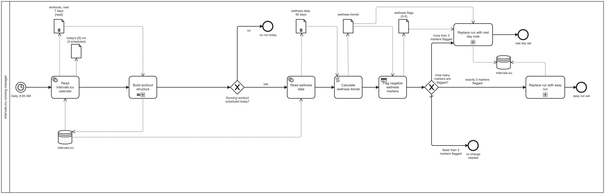

# INTERVALS.ICU RUNNING MANAGER

Automatic adjustment of a running plan, built with Make, BPMN 2.0 and DMN

Author: Hubert Jastrzębski

Version: 1.0, diagram 1.0.bpmn, Make blueprint exported 16.10.2026

*Main process (1.0.bpmn). The three sub-processes are in section 5.5.*

This file is the only documentation of the project. The Make scenario and the diagrams carry names; explanations live here.

**Contents**

1. IN SHORT
2. WHY IT EXISTS
3. HOW IT WORKS, IN PLAIN WORDS
4. WHAT THIS PROJECT SHOWS
5. UNDER THE HOOD
    - 5.1 Platform
    - 5.2 Reading data
    - 5.3 Route 1: Build workout structure
    - 5.4 Route 2: Adjust today's run
    - 5.5 Process model
    - 5.6 Errors
    - 5.7 Cost
6. DESIGN DECISIONS
7. KNOWN LIMITATIONS
8. RUNNING, TESTING, REUSING
    - 8.1 Daily use
    - 8.2 Testing
    - 8.3 Reusing the scenario
9. PLANNED IMPROVEMENTS
10. FILES IN THIS FOLDER

## 1. IN SHORT

intervals.icu running manager is a personal automation that keeps my running plan usable on my Garmin watch and adapts each day's run to how well I have recovered. It runs on its own every morning at 08:00.

1.1 It turns the text-only runs from my TrainerRoad plan into structured workouts (steps with pace targets) that intervals.icu sends to the watch. An AI model reads each description and writes the steps.

1.2 It compares five recovery markers from my watch with my own 60-day normal. If 4 or 5 of them look bad, the day's run becomes a rest day; if 3 do, it becomes an easy run; otherwise nothing changes.

Built with Make (no-code automation), the intervals.icu REST API, Anthropic Claude (AI model), BPMN 2.0 (process model) and DMN (decision table).

Status: switched on 16.10.2026, after tests on real and on deliberately faked data (section 8.2).

## 2. WHY IT EXISTS

- My running plan comes from TrainerRoad. Its runs reach intervals.icu, the training calendar that also sends planned workouts to my Garmin watch, only as a name and a text description such as "10min Easy RPE4, 6x3min Very Hard RPE8, 3min easy". Without steps and pace targets the watch can't guide the session.
- A fixed plan also doesn't react to a bad night or to built-up fatigue, and checking that by hand every morning is easy to skip.
- It is also a portfolio project: the full path from process analysis and modelling (BPMN, DMN) to a working automation (Make), tested and documented together with its limits.

## 3. HOW IT WORKS, IN PLAIN WORDS

Every morning the scenario does three things, in this order.

3.1 Prepare the coming week. It looks at today and the next seven days. Every TrainerRoad run that is still plain text and has no structured copy yet goes to an AI model, which rewrites the description as steps, for example "10 minutes easy, then 6 x 3 minutes fast with 3 minutes easy in between". A fixed key translates TrainerRoad's effort scale (RPE 2-10) into my pace zones, so the AI doesn't guess intensities. The result is saved as a new workout marked "[S]" (structured) next to the original. Because this happens up to a week ahead, today's run normally has its structured copy already.

3.2 Check recovery. If a structured run is planned for today, it takes the last 60 days of watch data and compares the recent values with my own average:

- heart rate variability (HRV, 7-day average) more than 7% lower than usual,
- resting heart rate more than 15% higher than usual,
- sleep score more than 15% lower than usual,
- sleep time more than 15% shorter than usual,
- training form (TSB: fitness minus fatigue) below -30, meaning a lot of built-up fatigue.

Each marker that crosses its line is one flag. A marker without a reading doesn't count.

3.3 Decide.

- 4 or 5 flags: rest day. Today's run is removed, and a note in the calendar lists the flags and the numbers behind them.
- 3 flags: easy day. Today's run is replaced by one easy run at 77-83% of threshold pace, as long as the planned run but at most 60 minutes.
- 0-2 flags: the plan stays as it is.

Two safety rules: the scenario only ever deletes its own structured copies, never TrainerRoad's originals; and it creates the replacement before it removes the original, so a failure leaves too much on the calendar, never too little. If anything fails, the run stops and Make sends me an email.

## 4. WHAT THIS PROJECT SHOWS

- Process analysis and modelling: the whole process is modelled in BPMN 2.0 (one main process, three sub-processes) and the recovery rule as a DMN decision table. The diagram follows the automation step for step (mapping in section 5.5).
- Low-code automation in Make: REST API calls with authentication (GET, POST, DELETE), iterators, a router, filters, if-else branching, data mapping and formulas.
- An AI model as one step of a process: a prompt with a fixed output format, an agreed "can't do it" answer, and extraction of the result without code.
- Working with data: personal baselines from 60 days of readings, missing values handled on purpose, and a fatigue figure corrected so that today's planned workout isn't counted twice.
- Risk control: duplicate prevention, guarded deletes, a deliberate order of steps, and tests with controlled fake data before going live.
- Documentation: one source of truth (this file), with known limitations and open issues stated.
- Scale: a personal tool for one athlete, running on Make's free plan.

## 5. UNDER THE HOOD

### 5.1 Platform

- Make scenario "Intervals ICU running manager" (Make free plan), scheduled every day at 08:00. All date calculations use the Europe/Warsaw time zone.
- intervals.icu REST API at https://intervals.icu/api/v1 with HTTP Basic authentication (user name API_KEY, password = the API key). The key is stored in Make's credentials, not in the blueprint. Athlete 0 means "the owner of the key".
- In this account intervals.icu keeps two calendars: calendar_id 2 holds events imported from Garmin (that is where TrainerRoad's runs arrive), calendar_id 1 is intervals.icu's own calendar, where this scenario writes.

### 5.2 Reading data

- One calendar read at the start: GET /athlete/0/events from today to today + 7. Both routes work from this one snapshot.
- Wellness read: GET /athlete/0/wellness from today - 59 to today, one record per day (hrv, restingHR, sleepScore, sleepSecs, ctl, atl), null where there was no reading.

### 5.3 Route 1: Build workout structure (Make finishes route 1 for every event before it starts route 2)

- Iterator 3 emits one bundle per event.
- Filter "unstructured run": category WORKOUT, type Run, no steps, and no event in the snapshot whose external_id equals this event's uid (so no [S] copy yet).
- Anthropic Claude, Simple text prompt: Make's built-in AI connection (no own API key), model Claude Haiku 5.5, max. 1000 tokens. The prompt holds the rules, the RPE-to-pace key, one worked example and an output contract: the workout between WORKOUT_START and WORKOUT_END, or UNPARSEABLE.
- Set variable workout_text: the text between the two markers, cut out with split, last and first.
- Filter "convertible": meant to stop replies without a workout or with UNPARSEABLE.
- POST /athlete/0/events: name "[S]" + original name, same date, type and category; description = the steps, a blank line, then TrainerRoad's original text; external_id = the original's uid. intervals.icu turns the step lines into a structured workout (workout_doc).

### 5.4 Route 2: Adjust today's run

- Iterator 20 goes over the same snapshot. Filter "run scheduled today" lets through events that start today and are a WORKOUT of type Run with steps; in practice that is the [S] copy.
- Read wellness data, then Calculate wellness trends (Set multiple variables: 7- and 60-day HRV, today's and 60-day resting HR, sleep score and sleep time, this morning's TSB).
- Flag negative wellness markers: one formula with result 0-5, the same rules as the DMN table (section 5.5).
- If-else "How many markers are flagged?" (exclusive, checked in order): 4 or more goes to "Swap for rest day", 3 or more to "Adjust workout", anything else to Else, which is empty.
- Swap for rest day: POST a NOTE called "Rest day flagged [Make]" with the flag count and the values, then, behind the filter "safe to delete", DELETE the [S] run.
- Adjust workout: POST "[S] Recovery Swap" with one step "- N m 77-83% Pace", where N = min(planned moving time, 60 min), then the same guarded DELETE.
- Filter "safe to delete": id > 0 and calendar_id = 1 (number comparisons), so only intervals.icu's own events can ever be deleted.
- The note and the replacement keep the original's external_id (the TrainerRoad uid). If the scenario runs again the same day, route 1 still sees that run as handled.

### 5.5 Process model

- 1.0.bpmn mirrors the scenario one to one. Conventions: HTTP and AI modules are service tasks; Set variable(s) modules are script tasks; the flag formula is a business rule task backed by the DMN table; filters and the If-else are exclusive gateways, and the If-else's Else is the default flow; an Iterator is a sequential multi-instance sub-process; intervals.icu is a data store; data in transit are data objects with their state in [brackets]. The Router has no symbol of its own: Make finishes route 1 before route 2, so the diagram draws them one after the other.
- wellness flags.dmn: decision table “Flag negative wellness markers”, hit policy COLLECT + SUM, five inputs, result 0-5.

*Sub-process: Build workout structure*

*Sub-process: Replace run with rest day note*

*Sub-process: Replace run with easy run*

### 5.6 Errors

- No error handlers (a deliberate choice, section 6). "Stop on HTTP error" is on in all seven HTTP modules, so any answer outside 2xx is an error. Make's default then applies: the run stops at the failing module, later modules and bundles don't run, and changes already made stay. Scenario setting "consecutive errors" = 3: after three failed runs in a row Make switches the scenario off. Make emails on errors and when it switches a scenario off (Profile > Email preferences). Incomplete executions are off.

### 5.7 Cost

- From the run history and the module count: 3 credits on a day without a run, 6 on a run day with fewer than 3 flags, 8 on a day with a swap, and roughly 10-16 when new runs are converted (the AI call adds a fraction of a credit for tokens on top of the module credits). Estimated total: about 150-250 of the free plan's 1,000 credits a month.

## 6. DESIGN DECISIONS

6.1 Copy, don't overwrite. TrainerRoad's runs arrive through the Garmin import; they come back after being deleted, and changing them in place didn't work. So the scenario never touches them and writes a separate "[S]" copy.

6.2 Pair by id, not by name or date. Each copy stores the original's uid in external_id. The duplicate check, safe re-runs and any future clean-up rely on that exact link.

6.3 A strict contract for the AI: a fixed RPE-to-pace key, a worked example, the markers WORKOUT_START and WORKOUT_END around the answer (tags like `<workout>` don't work, because `<` and `>` are operators in Make's formula language), and UNPARSEABLE as the agreed "can't do it" answer.

6.4 This morning's form from yesterday's numbers. intervals.icu's fitness (CTL) and fatigue (ATL) for today already include today's planned workout, which hasn't happened yet and is even counted twice once the [S] copy exists. So TSB = CTL(yesterday) x 41/42 - ATL(yesterday) x 6/7, i.e. one day of the 42- and 7-day exponential decay. TSB is used as an absolute value (Joe Friel's form), with the line at -30.

6.5 A missing reading is not a flag. The check errs towards "no change" rather than inventing fatigue.

6.6 My thresholds for flags, not a standard: HRV -7%, resting HR +15%, sleep score -15%, sleep time -15%, TSB -30.

6.7 One formula instead of more branches: the 60-minute cap is min(planned time, 60 min) inside the create step.

6.8 Create first, delete second. If the delete fails, both the note (or the easy run) and the original stay visible. I check the calendar anyway, so a contradiction I can see is better than a gap I can't. Editing the run in place (a single update call) was rejected: changing a workout that is already on the Garmin watch is riskier than adding one and removing another.

6.9 Errors: email and stop. There is one user, and a failure is visible the same morning. Retries (Make's Retry handler with incomplete executions) were considered and left for later (section 9).

6.10 One run per day, which is how I train.

6.11 This file is the only documentation. Make modules have names but no notes, so explanations can't drift apart.

## 7. KNOWN LIMITATIONS

7.1 One run per day. The recovery check runs once for every structured run planned today. With two runs on one day, the wellness data is read and judged twice, and both runs can be changed (on a rest day that means two notes).

7.2 TrainerRoad's own runs are not handled in this version. Only the [S] copies are changed. The TrainerRoad original stays on the intervals.icu calendar and on the Garmin calendar, also on rest and easy days. Changes TrainerRoad makes after the copy exists (adapting, moving or deleting a run) are not carried over to the copy.

7.3 Errors mean an email and a stop. At the first failing step the morning run ends and nothing after it runs. A failure while converting runs (route 1) therefore also skips that day's recovery check. If the note or the easy run was created but the delete then failed, both stay on the calendar until I fix it by hand. After 3 failed mornings in a row Make switches the scenario off.

7.4 The recovery check needs last night's watch data. Resting HR, sleep score and sleep time use today's reading: if the watch didn't record the night, or it hasn't synced to intervals.icu by 08:00, those three markers can't flag. HRV uses a 7-day average and still works with one night missing; TSB doesn't need the watch. With those three missing, at most 2 markers can flag, so the run can't change that day.

7.5 Structure is added up to 7 days ahead, so on the day itself the run normally has its [S] copy already. A run that TrainerRoad adds or moves to today at the last minute only gets its copy during that morning's run, but the recovery check works from the calendar as it was read at 08:00, before the copy existed, so that run isn't checked or adjusted that day. A run added to today after 08:00 never gets a copy at all, because the next morning's window starts on the next day.

7.6 The thresholds are not researched values: all markers weigh the same, the baselines are plain 60-day averages that include today, and nothing adapts over time.

7.7 The AI's conversion is only checked for format. Wrong but well-formed steps go through, so the [S] copy is worth a look. A description the AI marks UNPARSEABLE is meant to stay unconverted and be tried again each morning, one AI call per day.

7.8 TrainerRoad's original text is pasted below the steps. A line in it that starts with "- " would be read by intervals.icu as an extra step.

7.9 The easy run's length is intervals.icu's planned duration of the original (moving_time), and its pace target needs a threshold pace set in intervals.icu. For a run planned only by distance, that duration is intervals.icu's estimate.

7.10 Make's free plan: about 1,000 credits a month (section 5.7), and the AI step uses Make's built-in AI connection with Claude Haiku.

7.11 Account-specific values: dates are worked out for Europe/Warsaw, and the meaning of calendar_id 1 and 2 is what this account uses.

## 8. RUNNING, TESTING, REUSING

### 8.1 Daily use

- Nothing to do. A note "Rest day flagged [Make]" or an "[S] Recovery Swap" in the calendar means the scenario changed that day.

### 8.2 Testing

- Conversion: with an unstructured TrainerRoad run in the next 7 days, click Run once, check the [S] copy's steps, then click Run once again and check that no duplicate appears.
- Recovery branches: in intervals.icu, enter fake wellness values for today (enough to trip 3, or 4 or more, markers), click Run once in the Make editor and check the calendar. Then put the real values back (fake values distort the 60-day baselines) and remove the test note or run by hand. For a dry run, switch the two DELETE modules to GET first.
- Done so far: conversion and duplicate check 12-14.10.2026; rest day (4 of 5 flags, fake data) 15.10; easy run (3 flags, fake data) 16.10; the 60-day HRV average checked by hand (5,425 / 51 readings = 106.37).

### 8.3 Reusing the scenario

- Import Intervals ICU running manager.blueprint.json into a new Make scenario (Import blueprint).
- Create a Basic auth credential (user name API_KEY, password: your intervals.icu API key) and select it in all seven HTTP modules.
- Create a data structure "intervals event" with the fields name, type, category, start_date_local, description and external_id, and select it in the three POST modules.
- Check your calendar ids: the delete guard assumes calendar_id 1 is intervals.icu's own calendar.
- Change Europe/Warsaw in the five date formulas, and set the schedule.
- Adapt the RPE-to-pace key in the prompt to your zones. The targets use intervals.icu's pace zones and threshold pace.

## 9. PLANNED IMPROVEMENTS

- Remove TrainerRoad's originals from the Garmin calendar (a separate scenario).
- Wait for the night's data: start earlier and retry until today's wellness has synced.
- Retries for temporary errors (Make's Retry handler with incomplete executions).
- A weighted HRV average, and thresholds tuned on real data.
- Strip a leading "- " from the pasted TrainerRoad text.
- Delete an [S] copy whose steps come back empty, so that the run is tried again.
- Garmin-only metrics (lactate threshold, race predictor), entered by hand or read with the unofficial python-garminconnect library.

## 10. FILES IN THIS FOLDER

- README.md: this file, the only documentation
- Intervals ICU running manager.blueprint.json: Make export of the scenario (no credentials inside)
- 1.0.bpmn: current process model (bpmn.io or Camunda Modeler)
- 1.0.png, Build workout structure.png, Replace run with rest day.png, Replace run with easy run.png: the main process and its three sub-processes as images
- wellness flags.dmn: decision table for the recovery flags
